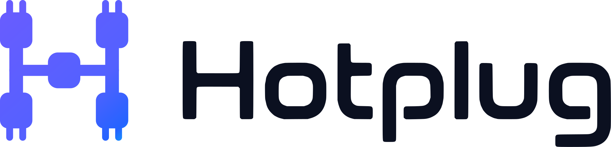

<p align="center">
  <picture>
    <source media="(prefers-color-scheme: dark)" srcset="assets/logo-dark.svg">
    
  </picture>
</p>

<p align="center"><b>Pick any. Code on.</b></p>

AnyPick connects the AI accounts and API keys you already have to the coding
apps you use. Pick a login for each app; AnyPick writes the app's config and,
when the app and the provider speak different protocols, runs a local
translator for it. Native desktop apps for macOS, Linux and Windows, plus a
CLI and terminal UI.

<p align="center">
  <a href="https://github.com/outof0/anypick/releases/latest"><b>Download</b></a>
  &nbsp;·&nbsp;
  <code>npm install -g anypick</code>
  &nbsp;·&nbsp;
  <a href="https://anypick.dev/docs/getting-started/"><b>Docs</b></a>
</p>

<!-- supported-summary:start (generated by `make readme-supported`; do not edit) -->

Works with **11 coding apps** (Claude Code, OpenAI Codex, Gemini CLI, OpenCode and 7 more) and **32 sources**: 9 you sign in to or reuse an existing login for, the rest by API key. [Full list](#supported).

<!-- supported-summary:end -->

## Install

Download from [GitHub Releases](https://github.com/outof0/anypick/releases/latest):

| Platform | Install | Requirements |
| --- | --- | --- |
| macOS desktop | `.dmg`/`.zip` or Homebrew cask | macOS 14+; not notarized |
| Windows desktop | `.msi` or NSIS `.exe` installer | x64 |
| Linux desktop | `.AppImage`, `.deb` or `.rpm` | x64 |
| CLI | npm, Homebrew, Scoop, or GitHub archive | npm needs Node 18+ |

The CLI and terminal UI, on any of those platforms:

```bash
npm install --global anypick   # Node 18+
anypick --version
```

The npm package is a thin launcher. On first run it downloads the matching
checksum-verified native CLI from GitHub Releases into `~/.cache/anypick`. The
same CLI archives (macOS Intel/Apple Silicon, Linux x64/arm64, Windows
x64/arm64) are attached to every release if you prefer to install by hand.

Install the CLI or desktop app with Homebrew, or the CLI with Scoop:

```bash
brew install outof0/tap/anypick
brew install --cask outof0/tap/anypick
scoop bucket add outof0 https://github.com/outof0/scoop-bucket
scoop install anypick
```

The macOS app is not notarized. On first launch, right-click `AnyPick.app` and
choose **Open**, or go to **System Settings → Privacy & Security → Open Anyway**.
You can also clear its quarantine flag with:

```bash
xattr -dr com.apple.quarantine /Applications/AnyPick.app
```

> [!NOTE]
> **Breaking change in 1.1.0 for npm users.** `anypick` on npm used to be the
> 1.0.0 JavaScript CLI. From 1.1.0 it launches the
> native CLI, which does not run third-party plugins (ADR 0021). Pin
> `anypick@1.0.0` if you still need the old package.

Homebrew and Scoop metadata is published to the configured `outof0` tap and
bucket as part of the default release. See [Release channels](#release-channels).

### Uninstall and rollback

- **npm CLI**: `npm uninstall --global anypick`, then delete the downloaded
  binary cache (`~/.cache/anypick` on macOS/Linux,
  `%LOCALAPPDATA%\\AnyPick` on Windows).
- **macOS app**: `brew uninstall --cask outof0/tap/anypick`, or quit AnyPick
  and move `AnyPick.app` to the Trash. Local data
  stays in `~/.anypick`; delete that directory only if you also mean to remove
  every saved account, proxy state, and activity entry.
- **Windows/Linux installers**: uninstall through Settings → Apps (MSI/NSIS) or
  your distribution's package manager.
- **Rollback**: install the previous release from the GitHub Releases page. The
  app and CLI are self-contained; `~/.anypick` data is forward-compatible, and
  account backups (readable JSON) are the supported way to move credentials.

## Release channels

The default `all` release builds macOS, Linux and Windows desktop apps, all six
CLI archives, and the npm launcher. It also updates the configured Homebrew and
Scoop repositories. `cli-only` narrows the artifacts to CLI archives.

- **Homebrew:** CI updates [`outof0/homebrew-tap`](https://github.com/outof0/homebrew-tap)
  with the CLI formula and macOS app cask. Use `brew install outof0/tap/anypick`
  for the CLI or `brew install --cask outof0/tap/anypick` for the app.
- **Scoop:** CI updates [`outof0/scoop-bucket`](https://github.com/outof0/scoop-bucket)
  with the Windows CLI manifest.
- **WinGet:** the release workflow generates the Windows desktop manifest;
  submit it to `microsoft/winget-pkgs` and wait for acceptance.

## Supported

Every row below is generated from the provider and client registries that ship
in the app (`src/go/internal/docsync`); `make test` fails if this table drifts.

<!-- supported:start (generated by `make readme-supported`; do not edit) -->

**Coding apps** AnyPick can point at a saved source:

Claude Code (`claude`) · OpenAI Codex (`codex`) · Command Code (`commandcode`) · DeepSeek Harness (`dsh`) · Gemini CLI (`gemini`) · Kiro (`kiro`) · Omp (`omp`) · OpenCode (`opencode`) · Pi (`pi`) · WorkBuddy AI (`workbuddy`) · ZCode (`zcode`)

| Source | Connect with | ID |
| --- | --- | --- |
| Anthropic Claude Code | Sign in, or save your existing login | `claude` |
| Cline | Sign in, or save your existing login | `cline` |
| Google Gemini | Sign in, or save your existing login; Gemini API key | `gemini` |
| Kiro | Sign in, or save your existing login | `kiro` |
| OpenAI Codex | Sign in, or save your existing login | `codex` |
| OpenCode | Save your existing login | `opencode` |
| WorkBuddy AI | Sign in, or save your existing login | `workbuddy` |
| xAI Grok | Sign in, or save your existing login | `grok` |
| Z.ai (GLM) | Sign in, or save your existing login; GLM Coding Plan key | `zai` |
| Cerebras Inference | Cerebras API key | `cerebras` |
| Cloudflare AI Gateway | Cloudflare API token | `cloudflare-aigateway` |
| DeepSeek | DeepSeek API key | `deepseek` |
| Doubao (Volcengine Ark) | Ark API key | `doubao` |
| Fireworks AI | Fireworks API key | `fireworks` |
| Groq | Groq API key | `groq` |
| GroqCloud (native /responses) | Groq API key | `groq-cloud` |
| MiniMax | MiniMax API key | `minimax` |
| Mistral AI | Mistral API key | `mistral` |
| ModelScope | ModelScope SDK token | `modelscope` |
| Moonshot Kimi | Moonshot API key | `kimi` |
| NVIDIA NIM | NVIDIA API key | `nvidia-nim` |
| OpenCode Go | OpenCode Go subscription key | `opencode-go` |
| OpenCode Zen | OpenCode API key | `opencode-zen` |
| OpenRouter | OpenRouter API key | `openrouter` |
| Qwen (DashScope) | DashScope API key | `qwen` |
| SiliconFlow | SiliconFlow API key | `siliconflow` |
| StepFun | StepFun API key | `stepfun` |
| Tencent Cloud TokenHub | TokenHub API key or TokenHub Coding Plan key | `tokenhub` |
| Tencent Hunyuan | Hunyuan API key | `hunyuan` |
| Together AI | Together API key | `together` |
| Volcengine Ark / BytePlus ModelArk | Ark platform API key or Ark Coding Plan key | `ark` |
| Xiaomi MiMo | MiMo API key (sk-…) or MiMo Token Plan key (tp-…) | `mimo` |

<!-- supported:end -->

The desktop app, CLI and terminal UI share one Go engine, so the same apps and
sources work on macOS, Linux and Windows. Which app can use which source is
decided per pair by `TransportFor` in `src/go/internal/transport`.

## Mental model

| Word | Meaning |
| --- | --- |
| **Client** | The coding tool being configured, such as Claude Code or Codex CLI |
| **Source** | A saved account, API gateway, proxy pool, Proxy Hub, or preset |
| **Binding** | A concrete client → source selection, including model roles |
| **Preset** | A stored binding template (`@name`); the CLI can resolve and inspect one, but no command creates one yet |

```text
use   = set the default binding
run   = launch with an effective binding
link  = set a project-local binding
```

Examples:

```bash
anypick add account codex --current --name personal
anypick use codex --with codex/personal
anypick run codex

anypick add gateway openrouter-work \
  --provider openrouter \
  --endpoint https://openrouter.ai/api/v1 \
  --api-key "$OPENROUTER_API_KEY"
anypick use claude --with openrouter-work
```

Capability pairs are policy, not a Cartesian product. Read `TransportFor` in
`src/go/internal/transport` before documenting a new client/source combination.

## Architecture

The production desktop direction is app-first:

```text
AnyPick.app (SwiftUI)
├── main System Settings-style window
├── menu-bar quick panel
└── Contents/Helpers/anypick-core
    └── anypick desktop-service --stdio
```

The native app is the lifecycle owner. It launches the bundled Go helper by a
bundle-relative path, performs a version/capability handshake, receives bounded
protocol frames, supervises bounded restarts, and stops the child on explicit
Quit. Closing the main window does not quit the app. The menu-bar item is a
compact surface of the same app, not a separate tray utility and not its parent.

The helper contains the desktop service and domain behavior. Raw credentials
and per-instance proxy secrets stay behind the Go boundary. The desktop
transport is private, versioned stdio; it is not a public localhost API or a
permanent daemon.

See [ADR 0020](adr/0020-node-free-native-app-distribution.md) for the accepted
cutover decision and [the macOS source contract](src/macos/README.md) for the UI
and lifecycle implementation.

AnyPick is one Go engine. The macOS app is Swift, the CLI and the terminal UI
are Go. There is no second runtime: the npm package is only a thin launcher
that downloads the matching checksum-verified Go CLI (ADR 0020).

## Run from source

Neither flow below creates a supported release artifact.

### Native macOS app

Requirements: macOS 14+, Xcode, and a Go launcher capable of selecting the
toolchain pinned in `src/go/go.mod`.

```bash
open src/macos/AnyPick.xcodeproj
```

Select the shared **AnyPick** scheme and Run. The Xcode build phase compiles the
pinned Go service for the target architecture, places it at
`AnyPick.app/Contents/Helpers/anypick-core`, and signs the nested helper before
the outer app when signing is enabled. The project references the Swift files in
`src/macos/` directly; it does not keep a second production source tree.

Useful checks:

```bash
xcodebuild -project src/macos/AnyPick.xcodeproj -scheme AnyPick \
  -destination platform=macOS CODE_SIGNING_ALLOWED=NO test
```

The app is one binary with two data sources: run it with no environment
variables and it talks to the Go service over `~/.anypick`; set
`ANYPICK_MACOS_FIXTURE` and it renders an in-memory fixture instead, with no
service and no disk access. Set it in the scheme (**Product → Scheme → Edit
Scheme → Run → Arguments → Environment Variables**), then Run. The full list of
fixture variables is in `src/macos/README.md`.

Users of a distributed app will not compile Swift or Go at runtime.

### CLI and terminal UI

Requirements: the Go toolchain pinned in `src/go/go.mod` (Go 1.26+).

```bash
cd src/go
go build -o /tmp/anypick ./cmd/anypick
/tmp/anypick --help
/tmp/anypick tui          # interactive terminal UI (bubbletea)
```

Or use the Makefile, which builds the same binary and pins a writable module
cache (see the note on `GOPATH` in `AGENTS.md`):

```bash
make run ARGS="--help"
make run ARGS="tui"
make sandbox ARGS="providers"   # throwaway HOME + ANYPICK_HOME
```

The terminal UI is `src/go/internal/tui`. It reads the services directly rather than
shelling out to the CLI, and it refuses to start without a TTY on stdin so a
piped invocation fails fast instead of hanging.

## Development commands

```bash
make test          # go test ./... -count=1
make test-race     # the same under -race
make vet
make fmt-check     # fails if anything is not gofmt-clean
make help          # the full list
```

CI (`.github/workflows/ci.yml`) runs the same gates: format and vet and version
sync, Go tests on Ubuntu and Windows, the macOS app and helper contract, and the
docs site.

> **Prefer `make` over a bare `go`.** The Makefile pins `GOPATH` to
> `$HOME/go` and finds the toolchain. A shell that exports `GOPATH` at
> another project's module cache makes tests that shell out to `go build`
> stall in module resolution. If you invoke `go` directly:
> `GOPATH=$HOME/go go test ./...` (warm once with `go mod download all`).

The documentation site is a separate pnpm project:

```bash
cd docs && pnpm install && pnpm build
```

The local data directory is `~/.anypick`; `ANYPICK_HOME` overrides it. Account
and configuration mutations touch real developer credentials, so use an
isolated `ANYPICK_HOME` when experimenting.

The loopback `anypick serve` status API also exposes `GET /agents`: a
credential-free worker manifest for local coordinators. It reports installed
clients, the saved route, provider-owned transport capability, selected model,
and proxy health. Credentials, gateway URLs, proxy tokens, and filesystem
paths never cross that boundary. `anypick doctor --json` includes the same
redacted proxy-environment diagnostics, including mixed-case environment
conflicts that can make a spawned worker take a different network path.

## Current platform status

Releases are produced by the GitHub Actions workflow after the selected scope's
verification and target-OS smoke gates pass. The default `all` scope includes
the macOS app, Linux and Windows installers, CLI archives and npm launcher.
The macOS app uses an ad-hoc code signature in CI and is not notarized;
first-launch approval steps are listed above.

- The macOS 14+ SwiftUI target and bundled universal Go-helper build exist in
  source and ship as a universal `.dmg` and `.zip` in `all` releases.
- The Tauri Linux/Windows apps build installers in the default `all` scope.
  Before staging, `packaging/smoke/` extracts
  each Linux deb/AppImage/rpm and the Windows MSI and runs the bundled Go helper
  (`--version` + `providers`) in a throwaway HOME. The GUI is not launched.
- The CLI release job builds macOS Intel/Apple Silicon, Linux x64/arm64, and
  Windows x64/arm64 archives. `npm/anypick` selects only those archives.
- Homebrew and Scoop publish to their external repositories during the default
  release. The release also attaches WinGet manifests when Windows desktop is
  included; WinGet requires a PR to
  `microsoft/winget-pkgs`.

## Documentation

- [Distribution and release operations](packaging/README.md)
- [Documentation site source](docs/src/content/docs/index.mdx)
- [Contributing](CONTRIBUTING.md)
- [Architecture decisions](adr/README.md)
- [Security policy](SECURITY.md)

AnyPick is licensed under the [MIT License](LICENSE).
